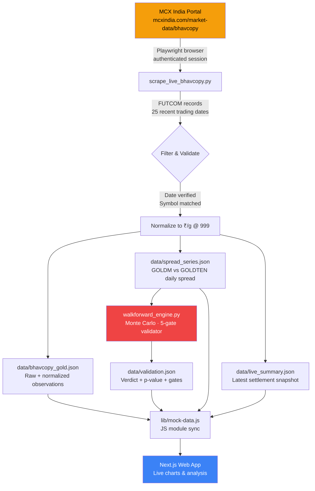

# SpreadForge

**Institutional-grade spread forensics for MCX Gold futures — built on real exchange data, not simulations.**

SpreadForge is a quantitative analysis platform that scrapes official settlement data from the Multi Commodity Exchange of India (MCX), detects anomalous price divergences across gold futures contracts, and subjects every finding to a battery of statistical tests before presenting a verdict. It exists to answer one question honestly: **"Is this spread worth trading, or will fees eat my edge?"**


---

## The Problem

India's MCX lists four gold futures contracts — **GOLDM**, **GOLDTEN**, **GOLDGUINEA**, and **GOLDPETAL** — each with different lot sizes (100g, 10g, 8g, 1g), purities (995 vs 999 fine), and expiry cycles. Retail traders routinely spot "price gaps" between these contracts and assume they've found an arbitrage opportunity.

**They're almost always wrong.**

The apparent spread is contaminated by three factors that are invisible on a raw price chart:

| Hidden Factor | What It Does |
|---|---|
| **Purity mismatch** | GOLDM settles at 995 fineness while GOLDTEN/GUINEA/PETAL settle at 999. A naive price comparison carries a phantom 0.4% gap that has nothing to do with market mispricing. |
| **Lot-size & quotation differences** | GOLDM quotes ₹/10g, GOLDGUINEA quotes ₹/8g, GOLDPETAL quotes ₹/1g. Comparing raw prices is meaningless without normalizing to a common unit. |
| **Transaction costs** | MCX exchange fees, stamp duty, SEBI turnover charges, broker commissions, and execution slippage on retail-liquidity contracts can easily exceed ₹4,000 per round trip — dwarfing any basis-point spread movement. |

Most traders discover these realities *after* they've lost money. SpreadForge discovers them *before* a single rupee is risked.

---

## The Solution

SpreadForge takes a forensic, evidence-first approach:

### 1. Real Exchange Data — Zero Fabrication

Every data point originates from MCX's official Bhavcopy (settlement) records. The scraper authenticates with the exchange portal, extracts FUTCOM settlement prices for each trading session, and validates that the returned date matches the requested date. No synthetic extrapolation, no forward-curve padding, no demo data.

### 2. Purity & Quotation Normalization

All prices are converted to a single comparable unit: **₹ per gram of 999-fine gold**.

```
GOLDM (995 purity, ₹/10g)  →  (close ÷ 10) × (999/995)  →  ₹/g @ 999
GOLDTEN (999 purity, ₹/10g) →  close ÷ 10                 →  ₹/g @ 999
GOLDGUINEA (999 purity, ₹/8g)→  close ÷ 8                  →  ₹/g @ 999
GOLDPETAL (999 purity, ₹/1g) →  close ÷ 1                  →  ₹/g @ 999
```

### 3. Drop Detection & Attribution

Using a rolling-window algorithm (7-day before vs 7-day after), SpreadForge finds the date where the GOLDM–GOLDTEN spread experienced its steepest, most sustained change. It then decomposes the spread movement into its two contract legs, attributing how much each side contributed to the shift.

### 4. Five Mandatory Validation Gates

No finding is presented without surviving every gate:

| Gate | Test | Pass Criteria |
|---|---|---|
| **GATE 01** | Out-of-sample walk-forward | Strategy must produce ≥10 trades on unseen data |
| **GATE 02** | Double-cost sensitivity | Profitable even at 2× actual exchange fees |
| **GATE 03** | Parameter perturbation | Edge survives ±10% shifts in entry/exit thresholds |
| **GATE 04** | Monte Carlo shuffle (1,000 iterations) | Empirical p-value < 0.05 |
| **GATE 05** | 999 purity parity | Zero unhedged gold fineness exposure |

The honest verdict is one of two values: **`EDGE SURVIVES COSTS`** or **`NO EDGE AFTER COSTS`**. There is no middle ground.

### 5. AI-Powered Plain-English Explanation

An integrated AI agent (powered by Groq) translates the statistical output into simple language. Instead of staring at p-values and basis points, traders receive explanations like: *"You paid ₹4,200 to chase a small, random price blip in a messy market. The blip wasn't real."*

---

## Live Data Pipeline

The core of SpreadForge is a fully automated scraping and validation pipeline that keeps the platform's data synchronized with the MCX exchange.



### How the Scraper Works

1. **Session establishment** — Playwright launches a headless Chromium instance configured with Indian locale (`en-IN`), IST timezone, desktop viewport, and anti-detection headers to navigate MCX's Akamai-protected portal.

2. **Date-wise extraction** — For each of the 25 most recent weekdays, the scraper calls MCX's internal JSON API (`GetDateWiseBhavCopy`) with `X-Requested-With: XMLHttpRequest` and `Referer` headers that the exchange's CDN requires. Without these headers, the endpoint returns a 404 HTML page instead of JSON.

3. **Contract filtering** — Only `FUTCOM` instrument records with `OptionType: '-'` (futures, not options) for `GOLDM`, `GOLDTEN`, `GOLDGUINEA`, and `GOLDPETAL` are retained. For each symbol on each date, the contract with the highest volume is selected as the active near-month contract.

4. **Purity normalization** — GOLDM prices are multiplied by `999/995` to eliminate the fineness difference. All prices are divided by their respective quotation base to produce a uniform ₹/gram figure.

5. **Spread computation** — The percentage spread between GOLDM (normalized) and GOLDTEN is calculated for each trading session and written to `data/spread_series.json`.

6. **Walk-forward validation** — The `WalkForwardValidator` runs a deterministic spread-reversion backtest, then subjects the result to all five gates. The final verdict is written to `data/validation.json`.

7. **Data preservation** — If MCX returns zero sessions (cloud IP geo-blocking, WAF challenges, or portal maintenance), the pipeline preserves the existing verified dataset instead of overwriting it with empty data.

---

## GitHub Actions Workflow

The [`refresh-market-data.yml`](.github/workflows/refresh-market-data.yml) workflow automates the entire pipeline on a schedule:

| Trigger | Schedule |
|---|---|
| **Cron** | Mon–Fri at 17:35 IST (12:05 UTC), 5 minutes after MCX session close |
| **Push** | When `scrape_live_bhavcopy.py`, `walkforward_engine.py`, or the workflow file changes |
| **Manual** | `workflow_dispatch` from the GitHub Actions tab |

### What the Workflow Does

```
1. Checkout repo
2. Set up Python 3.12 with pip cache
3. Install playwright + numpy
4. Install Chromium browser with OS deps
5. Run scrape_live_bhavcopy.py (scrape → normalize → validate → sync)
6. If any data files changed:
   → Commit as github-actions[bot]
   → Push to main
7. Vercel auto-deploys on push → website shows fresh data
```

The committed data files (`data/*.json`, `lib/mock-data.js`, `public/sample_spread_data.csv`) are the **single source of truth** for the web application. When Vercel rebuilds the site from the updated `main` branch, every visitor sees the latest MCX settlement data without any manual intervention.

---

## Project Structure

```
spread-forge-development/
├── app/
│   ├── page.jsx                          # Main forensic dashboard (charts, suspects, verdict)
│   ├── globals.css                       # Tailwind + custom theme
│   ├── layout.jsx                        # Root layout with metadata
│   └── api/
│       ├── analyze/route.js              # Spread analysis engine (preset + CSV/XLSX upload)
│       ├── chat/route.js                 # AI explanation agent (Groq-powered)
│       └── market-data/
│           ├── historical/route.js       # Historical bhavcopy observations API
│           └── live-summary/route.js     # Latest settlement prices API
├── components/
│   ├── primitives.jsx                    # Animation primitives (Motion, Recharts wrappers)
│   ├── QuantAiChat.jsx                   # AI chat modal for plain-English explanations
│   └── ui/                              # Reusable UI components
├── lib/
│   ├── simulation.js                     # Client-side spread-reversion backtest engine
│   ├── market-data.js                    # Price normalization and alignment utilities
│   ├── mock-data.js                      # Auto-generated JS module (synced from live MCX data)
│   ├── simulation-context.jsx            # React context for simulation state
│   ├── run-storage.js                    # Local run persistence
│   ├── format.js                         # INR currency formatting
│   ├── *.test.js                         # Unit tests (18 tests, 100% pass rate)
│   └── utils.ts                          # Tailwind class merge utility
├── data/
│   ├── bhavcopy_gold.json                # Full MCX settlement dataset (all 4 contracts)
│   ├── spread_series.json                # GOLDM vs GOLDTEN daily spread time series
│   ├── live_summary.json                 # Latest trading session snapshot
│   └── validation.json                   # Walk-forward verdict + 5-gate results
├── python_pipeline/
│   ├── scrape_live_bhavcopy.py           # MCX portal scraper + full pipeline orchestrator
│   ├── walkforward_engine.py             # Statistical validator (Monte Carlo, sensitivity tests)
│   └── requirements.txt                  # Python dependencies (playwright, numpy)
├── .github/workflows/
│   └── refresh-market-data.yml           # Automated daily scrape + commit workflow
└── public/
    └── sample_spread_data.csv            # Downloadable sample for user uploads
```

---

## Getting Started

### Prerequisites

- **Node.js** ≥ 18
- **Python** ≥ 3.10
- **pnpm** (or npm)

### Installation

```bash
# Clone the repository
git clone https://github.com/your-username/spread-forge-development.git
cd spread-forge-development

# Install Node.js dependencies
pnpm install

# Install Python dependencies
pip install -r python_pipeline/requirements.txt

# Install Playwright browser
python -m playwright install chromium --with-deps
```

### Fetch Live MCX Data

```bash
python python_pipeline/scrape_live_bhavcopy.py
```

This single command runs the entire pipeline: scrape → normalize → validate → sync. All data files in `data/` and `lib/mock-data.js` are updated atomically.

### Run the Development Server

```bash
pnpm dev
```

Open [http://localhost:3000](http://localhost:3000) to see the dashboard with live MCX data.

### Run Tests

```bash
pnpm test
```

All 18 unit tests cover the simulation engine, run storage integrity, and market data normalization.

---

## Key Design Decisions

| Decision | Rationale |
|---|---|
| **Playwright over raw HTTP** | MCX's Akamai CDN requires browser-like session cookies and specific XHR headers. A headless browser handles TLS fingerprinting, cookie jars, and JavaScript challenges automatically. |
| **Data committed to Git** | The JSON data files are small (~55 KB total) and committing them means: (1) Vercel deploys include fresh data without runtime secrets, (2) every data update has a Git timestamp, and (3) the site works even if MCX is temporarily unreachable. |
| **Honest verdicts** | The platform is designed to tell traders **not** to trade when the edge doesn't survive costs. This is the opposite of most trading tools, which are designed to encourage activity. |
| **No stored user files** | Uploaded CSV/XLSX files are processed in-memory during the request and never persisted to disk or logged. |

---

## Environment Variables

Create a `.env.local` file for the AI chat feature:

```env
GROQ_API_KEY=your_groq_api_key_here
```

The GROQ API key powers the AI explanation agent. The rest of the platform (data scraping, analysis, charts) works without any API keys.

---

## Tech Stack

| Layer | Technology |
|---|---|
| **Frontend** | Next.js 16.4, React 19, Tailwind CSS 4, Recharts, Motion |
| **Backend API** | Next.js Route Handlers (App Router) |
| **Data Pipeline** | Python 3.12, Playwright, NumPy |
| **AI Agent** | Groq (Llama) via REST API |
| **CI/CD** | GitHub Actions (scheduled cron + push triggers) |
| **Hosting** | Vercel (auto-deploy on push to main) |
| **Data Source** | MCX India Official Bhavcopy Settlement Records |

---

## License

MIT

---

### Made with 💓 by Team MergeConflict

| | Member | GitHub |
|---|---|---|
| 👤 | **Kaustubh Bhardwaj** | [@kaustubh010](https://github.com/kaustubh010) |
| 👤 | **Dhruv Poddar** | [@Dhruv-Poddar-07](https://github.com/Dhruv-Poddar-07) |
| 👤 | **Goldy Choudhary** | [@Goldy0012](https://github.com/Goldy0012) |


